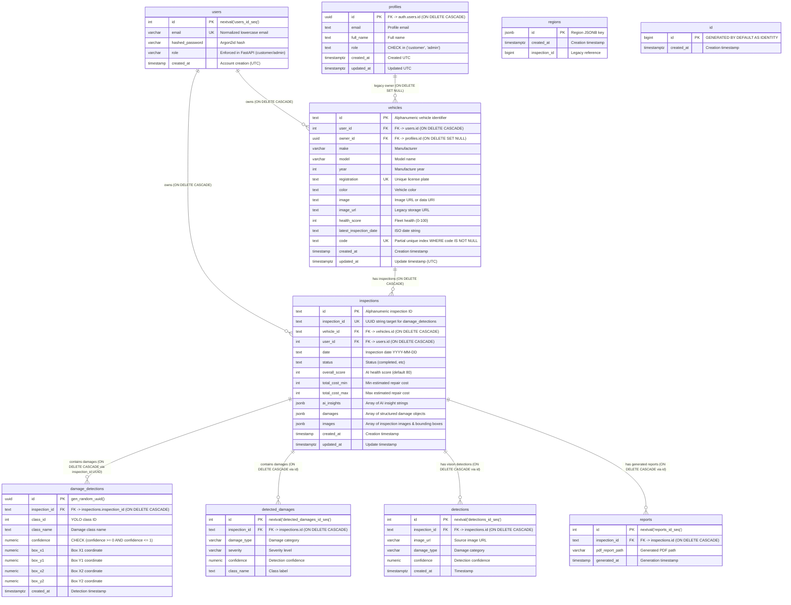

# AutoInspect AI — Database Entity-Relationship (ER) Diagram

This document contains the verified Mermaid Entity-Relationship diagram for the AutoInspect AI PostgreSQL database (Supabase PostgreSQL 17.11).

---

## 1. Physical Entity-Relationship Diagram

---

## 2. Relationship Cardinality & Delete Actions

1. **`users` to `vehicles` (`1:N`):**
   - Each customer user owns 0 or more vehicles.
   - A vehicle belongs to at most one user (`user_id`).
   - Legacy vehicles can have `user_id = NULL` (managed by admin).
   - `ON DELETE CASCADE`: Deleting a user deletes their vehicles.

2. **`vehicles` to `inspections` (`1:N`):**
   - Each vehicle has 0 or more inspection reports.
   - `ON DELETE CASCADE`: Deleting a vehicle automatically deletes all associated inspections.

3. **`inspections` to `damage_detections` (`1:N`):**
   - Linked via `inspections.inspection_id` (UUID string).
   - `ON DELETE CASCADE`: Deleting an inspection deletes all 69 associated damage detection rows.

4. **`inspections` to `detected_damages` (`1:N`):**
   - Linked via `inspections.id` (numeric string).
   - `ON DELETE CASCADE`: Deleting an inspection deletes associated detected damage rows.

5. **`inspections` to `detections` and `reports` (`1:N`):**
   - Linked via `inspections.id`.
   - `ON DELETE CASCADE`: Deleting an inspection removes any vision detections or exported PDF reports.

6. **`profiles` to `vehicles` (`1:N`):**
   - `ON DELETE SET NULL`: Deleting a legacy profile retains the vehicle data.

