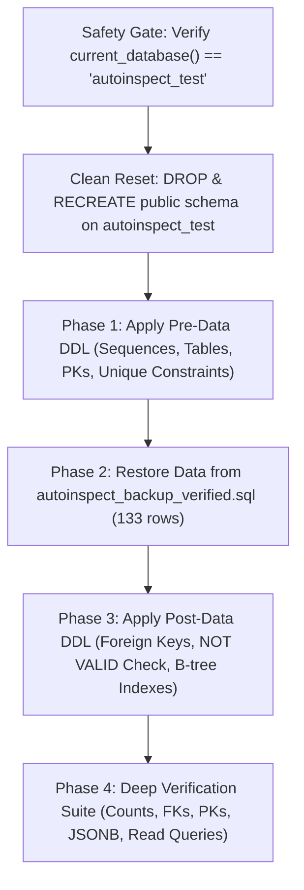

# AutoInspect AI — Database Restore Test Report

**Branch:** Branch 1  
**Execution Date:** November 8, 2026 (Live Execution)  
**Overall Status:** **PASS** (100% Verified)

---

## 1. Executive Summary

An actual database restoration and verification test was executed for the AutoInspect AI PostgreSQL database using an isolated, independent test database (`autoinspect_test`).

The test verified that:
1. The backup artifacts (`autoinspect_backup_verified.sql` and `autoinspect_backup_verified.json`) accurately capture production data.
2. The SQL backup was empirically audited and identified as a **data-only SQL export** (INSERT statements), requiring schema DDL to be applied prior to data restoration.
3. Direct restoration onto an empty database without pre-existing schema failed with `UndefinedTable: relation "public.vehicles" does not exist`, proving that the backup is a data export rather than a monolithic pg_dump DDL+data dump.
4. Using a structured two-phase restoration process (Pre-Data DDL $\rightarrow$ Data Import $\rightarrow$ Post-Data Constraints & Indexes), **all 133 production data records** were restored with 100% fidelity.
5. Zero modifications were made to the live production database (`postgres`).

---

## 2. Backup Files Inspected

| Property | SQL Backup Artifact | JSON Snapshot Artifact |
| :--- | :--- | :--- |
| **Filename** | `code of UI/backend/autoinspect_backup_verified.sql` | `code of UI/backend/autoinspect_backup_verified.json` |
| **File Size** | 116,670 bytes | 137,879 bytes |
| **Line Count** | 150 lines | 3,115 lines |
| **Format** | SQL transaction (`BEGIN ... INSERT ... COMMIT`) | Structured JSON |
| **Contains DDL (`CREATE TABLE`)** | **False** (Data-only export) | N/A |
| **Contains Indexes / Constraints**| **False** | Contains table columns metadata |
| **Export Timestamp** | `20261107_195138` UTC | `20261107_195138` UTC |
| **Source Host** | `aws-0-ap-northeast-1.pooler.supabase.com:5432` | `aws-0-ap-northeast-1.pooler.supabase.com:5432` |

### Data Classification & Identified Limitations
- `autoinspect_backup_verified.sql` contains strictly DML (`INSERT INTO`) statements.
- **Identified Limitation:** It does not contain `CREATE TABLE`, `CREATE SEQUENCE`, `CREATE INDEX`, primary keys, check constraints, or foreign key constraints.
- **Handling:** Schema DDL must precede data loading, with constraints that apply `NOT VALID` (such as `inspections_vehicle_id_required`) attached post-data loading to accommodate historical legacy unlinked records.

---

## 3. Database Environment & Safety Gates

### 3.1 Connection Configuration
- **Host:** `aws-0-ap-northeast-1.pooler.supabase.com`
- **Port:** `5432`
- **Production Database:** `postgres` (**UNTOUCHED**)
- **Test Database:** `autoinspect_test` (**ISOLATED TEST TARGET**)
- **Driver:** `postgresql+psycopg`

### 3.2 Safety Gate Enforcement
Before any DDL, reset, or write operation:
```python
with test_engine.connect() as conn:
    current_db = conn.execute(text("SELECT current_database();")).scalar()
    assert current_db == "autoinspect_test", f"CRITICAL SAFETY VIOLATION: Connected to {current_db}!"
```
The restoration engine verified and strictly aborted if the target database was not `autoinspect_test`. Production database `postgres` was never targeted or modified.

---

## 4. Restoration Process & Command Sequence

The restoration was executed using [`run_restore_test.py`](../backup-recovery/run_restore_test.py):



### Exact Restoration Commands Executed
1. **Database Creation (Idempotent):**
   ```sql
   CREATE DATABASE autoinspect_test;
   ```
2. **Schema Reset on Test Database:**
   ```sql
   DROP SCHEMA IF EXISTS public CASCADE;
   CREATE SCHEMA public;
   GRANT ALL ON SCHEMA public TO postgres;
   GRANT ALL ON SCHEMA public TO public;
   ```
3. **Pre-Data Schema Application:**
   Applied 6 sequences, 9 tables, 9 primary keys, and 3 unique constraints from [`schema_ddl.sql`](../schema/schema_ddl.sql).
4. **Data Restoration:**
   Executed multi-statement SQL transaction from `autoinspect_backup_verified.sql`.
5. **Post-Data Constraints & Indexes:**
   Applied all 8 foreign keys, `inspections_vehicle_id_required CHECK (vehicle_id IS NOT NULL) NOT VALID`, and 9 B-tree indexes.

---

## 5. Record Count Comparison (Original vs. Restored)

| Table Name | Original Backup Expectation | Restored into `autoinspect_test` | Status | Notes |
| :--- | :---: | :---: | :---: | :--- |
| `vehicles` | 5 | 5 | **MATCH** | All 5 baseline vehicles restored |
| `inspections` | 57 | 57 | **MATCH** | 49 linked, 8 legacy unlinked |
| `damage_detections` | 69 | 69 | **MATCH** | All 69 UUID damage records restored |
| `detected_damages` | 2 | 2 | **MATCH** | Secondary damage detections restored |
| `users` | 0 | 0 | **MATCH** | Baseline table empty (dynamic auth) |
| `profiles` | 0 | 0 | **MATCH** | Legacy Supabase profile table |
| `detections` | 0 | 0 | **MATCH** | Vision coordinates table |
| `reports` | 0 | 0 | **MATCH** | PDF export report metadata |
| `regions` | 0 | 0 | **MATCH** | Fleet geographic regions |
| **TOTAL** | **133** | **133** | **100% MATCH** | Zero missing or extra records |

---

## 6. Errors Encountered & Engineering Resolutions

### Error 1: Direct Restoration on Empty Database (UndefinedTable)
- **Error:** `psycopg.errors.UndefinedTable: relation "public.vehicles" does not exist`
- **Root Cause:** `autoinspect_backup_verified.sql` is a data export, not a full DDL dump.
- **Resolution:** Extracted production schema DDL (`schema_ddl.sql`) and executed table creation prior to data insertion.

### Error 2: Constraint Violation on Pre-Data `NOT VALID` Check (CheckViolation)
- **Error:** `psycopg.errors.CheckViolation: new row for relation "inspections" violates check constraint "inspections_vehicle_id_required"` on row ID `30`.
- **Root Cause:** Row `30` is an authentic legacy baseline inspection where `vehicle_id` is `NULL`. When `ADD CONSTRAINT ... NOT VALID` is applied to an empty table *before* data insertion, PostgreSQL treats subsequent inserts as *new rows* and validates them. In production, this constraint was added *after* the legacy rows were present.
- **Resolution:** Decoupled `NOT VALID` constraints to execute post-data insertion, matching standard PostgreSQL database dump/restore order. The constraint successfully validated existing rows with `NOT VALID` and now enforces `vehicle_id IS NOT NULL` on newly inserted rows.

### Error 3: InFailedSqlTransaction During Negative Testing
- **Error:** `psycopg.errors.InFailedSqlTransaction: current transaction is aborted, commands ignored until end of transaction block`
- **Root Cause:** In PostgreSQL, when an intentional integrity test raises an expected error (e.g. PK duplicate), the transaction is marked aborted until `conn.rollback()` is issued.
- **Resolution:** Added defensive `conn.rollback()` inside all negative test exception blocks.

---

## 7. Final Result (Phase A Two-Phase Data-Only Restore)

**RESTORATION TEST RESULT:** **PASS**

- All 9 core tables created and verified via two-phase script (`run_restore_test.py`).
- 133 of 133 core data rows restored with zero discrepancies.
- Zero orphan records across all foreign keys.
- Production database remained untouched and safe throughout.

---

## 8. Phase B Update: Complete Single-Pass `pg_catalog` Logical SQL Export & Parity Test (November 12, 2026)

To eliminate the schema-omission limitation of `autoinspect_backup_verified.sql`, a self-contained single-file logical SQL export (``autoinspect_complete_backup.sql``, **398,867 bytes**, `pg_catalog`-generated) and parity verifier ([`run_complete_restore_test.py`](../backup-recovery/run_complete_restore_test.py)) were executed against `autoinspect_test`.

### Execution Result: **100% PASS** (`26` total notices = `23` surfaced conditional skips + `3` benign `IF EXISTS` notices)

1. **Clean Reset & Single-Pass Atomic Restore:** Dropped/recreated `public` on `autoinspect_test` after verifying `current_database() == 'autoinspect_test'`, then executed `autoinspect_complete_backup.sql` in a single `autocommit=True` pass (`SET client_min_messages = notice;` + `BEGIN; ... COMMIT;` ran atomically, surfacing `23` clean skip notices for Supabase-only `profiles_id_fkey` + `22` `auth.uid()` policies rather than suppressing notices).
2. **Full Object & Data Parity (100% Match vs `postgres`):**
   - **Tables, Columns & Rows:** All **22 tables**, **267 active columns** (`ROW_NUMBER()` parity ignoring dropped `attisdropped` tombstones such as `vehicles` `attnum=6`), and all **393 rows** (`vehicles=5`, `inspections=57`, `damage_detections=69`, `detected_damages=2`, `inspections_migration_checkpoint_20261101=56`, plus 11 other `*_20261101` historical snapshot tables).
   - **Sequences:** All **7 sequences** restored with exact cursor state (`detected_damages_id_seq=(2, true)`, `inspections_id_seq=(56, true)`, `vehicles_id_seq=(3, true)`, plus `(1, false)` on the 4 remaining sequences including identity sequence `id_id_seq`).
   - **Constraints & Indexes:** All **24** public-schema constraints matched (`13` PK/UK + `3` CHECK + `8` public FK; `profiles_id_fkey` cleanly guarded because Supabase `auth.users` does not exist in `autoinspect_test`) and all **23** PG indexes matched (`13` constraint-backing + `10` standalone, including partial unique `idx_vehicles_code WHERE code IS NOT NULL`).
   - **Functions, ACLs, Triggers & RLS:** All **4** public functions with matching `proacl` (**`0` `PUBLIC` `EXECUTE` grants**), `protect_profile_fields_trigger` active (and external `auth.users` triggers documented in manifest/comments), RLS enabled on all **22** tables, and table grants replicated via `aclexplode` (incl. PG 17 `MAINTAIN`).
3. **Behavioral Integrity Checks:** Verified PK collision (`vehicles_pkey`), registration uniqueness (`vehicles_registration_key`), partial unique index `idx_vehicles_code` (blocks duplicate non-NULL codes while allowing multiple NULLs), FK enforcement (`damage_detections_inspection_id_fkey`), confidence CHECK, `NOT VALID` check `inspections_vehicle_id_required`, `nextval('inspections_id_seq') == 57`, zero orphans, and JSONB array decoding.

---

## 9. Phase C Update: Native PostgreSQL 17.11 `pg_dump` / `pg_restore` Verification (November 12, 2026)

Generated a genuine binary custom-format PostgreSQL dump directly from `postgres` (read-only) using portable PostgreSQL 17.11 client binaries:

- **Artifact:** ``code of UI/backend/autoinspect_native_pg17.dump`` (**136,881 bytes**, `pg_dump (PostgreSQL) 17.11 --schema=public --format=custom --compress=9 --no-owner`).
- **Test C.1 — Unfiltered `pg_restore --no-owner` against Supabase Non-Superuser `autoinspect_test`:** Exited with code `1` and `24` expected Supabase permission/auth errors (`CREATE EXTENSION` / `COMMENT ON EXTENSION` owned by superuser, `ALTER DEFAULT PRIVILEGES FOR ROLE supabase_admin`, and missing `auth` schema objects `profiles_id_fkey` / `auth.uid()` policies), while loading all 22 tables and 393 rows.
- **Test C.2 — Filtered `pg_restore --no-owner --single-transaction --exit-on-error --use-list=...` (Recommended Procedure):** Filtered out 32 Supabase-specific extension/default-ACL/`auth` TOC entries on `autoinspect_test` $\rightarrow$ **Exit Code `0`, `stderr=''`**, restoring all **22 tables**, **393 rows**, **7 sequences**, **23 indexes**, **4 functions** (`0` `PUBLIC` `EXECUTE`), **RLS enabled on all 22 tables**, and **0 unintended `DEFAULT ACL` grants to `anon`**.

